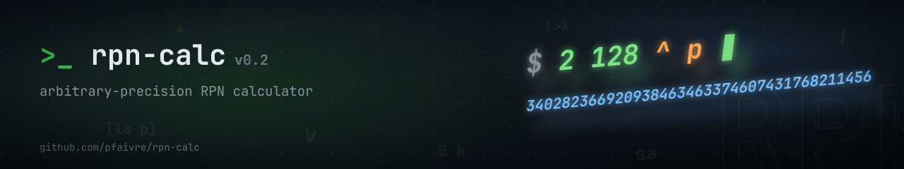

<p align="center">
  
</p>

# rpn-calc [](https://github.com/pfaivre/rpn-calc/actions/workflows/build-test.yml)
A humble dc clone, almost entirely compliant with it, with an emphasis on arithmetic correctness and execution safety.

## Synopsis
```sh
rpn [-V] [--version] [-h] [--help]
    [-e scriptexpression] [--expression=scriptexpression]
    [-f scriptfile] [--file=scriptfile] [file...]
```

## Description
This is a calculator that uses the reverse-polish notation (RPN).
It stores the numbers in a stack and operates with the top ones until the
desired result is reached.

For example the calculation `(3 + 5) * 7` can be noted as `3 5 + 7 *` in RPN.

See below for a complete set of commands.

Thanks to [GMP](https://gmplib.org/), it supports arbitrary precision
arithmetic.

## Options
rpn may be invoked with the following command-line options:

```sh
-V, --version
```
Print out the version of rpn that is being run and a copyright notice, then
exit.

```sh
-h, --help
```
Print a usage message briefly summarizing these command-line options, then exit.

```sh
-e, --expression=script
```
Execute the commands in script, one macro level above the top level (so `q`/`Q`
counting matches dc). Multiple `-e` options run in command-line order,
interleaved with `-f` files as given.

```sh
-f, --file=scriptfile
```
Read and execute scriptfile where it appears on the command line, in order
interleaved with `-e` options. The file name `-` reads the standard input.

```sh
file...
```
Read and execute each script file, in order, after all options, one line at a
time (like standard input lines; the stack, registers, scale and bases persist
across files). The file name `-` reads the standard input. An unreadable file
is an error but does not stop the session. After positional files, standard
input is read (as in dc); with only `-e`/`-f` options and no positional file,
standard input is not read.

## Input
Without any `-e`, `-f` or file argument, expressions are read from the
standard input, one per line; the stack persists across lines. With positional
files, the `-e`/`-f` options run first (in command-line order), then the files
in order, and the standard input follows them. Spaces, tabs and newlines separate tokens, and
spaces may be omitted between tokens (`2 3*4+p`). Negative numbers are written
with an underscore prefix (`_5`). Numbers may have a decimal point (`1.5`,
`.5`, `1.`); a second `.` starts a new token, so `1..2` is read as `1.` then
`.2`. Digits `A`-`F` (uppercase) are number digits too, read in the current
input base (`i`, default 10). A `#` starts a comment that runs to the end
of the line. A NUL byte ends the line for the parser: everything after the
first NUL byte is ignored.

The exit status is 0 when every command succeeded, and 1 if any command failed
(errors are reported on stderr) or an unknown option was given.

## Download
Prebuilt statically linked binaries are available on the
[releases page](https://github.com/pfaivre/rpn-calc/releases). Each archive
bundles the binary — named `rpn` on Linux, `rpn.exe` on Windows — together
with the [examples](examples/): `rpn-linux-x86_64.tar.gz` for Linux x86_64 (no
GMP installation needed) and `rpn-windows-x86_64.zip` for Windows x86_64 (no
MinGW or GMP DLLs needed).

```sh
$ tar -xzf rpn-linux-x86_64.tar.gz   # on Windows: unzip rpn-windows-x86_64.zip
$ ./rpn examples/mandelbrot.rpn
```

## Examples
[examples/](examples/) — also bundled alongside the binary in the release
archives — show what can be done with this calculator. You can try them with
rpn or dc:

```sh
$ ./rpn examples/plot.rpn
                              |                             
               *              |                             
                              |                             
                              |                             
                              |    ****                     
                *             |  **    *                    
                              | *       *                   
                              |                             
                 *            |*         *                  
------------------------------*-----------------------------
                             *|                             
                  *         * |           *                 
                              |                             
                   *       *  |                             
                    *    **   |            *                
                     ****     |                             
                              |                             
                              |                             
                              |             *               
                              |                             
```


## Commands
Commands are single tokens; spaces between them may be omitted (`2 3*4+p`). The
sections below group them by purpose.

### Strings and macros
`[...]` Pushes a string literal onto the stack. The outer brackets are not part of the string; inner bracket pairs are kept, so nesting works (`[[a]b]` pushes `[a]b`). Spaces, `#` and digits are allowed inside, and the literal may be written without separating spaces (`2[ab]p`). A literal not closed on the same line is an error.

`x` If the top value is a string, pops it and executes its contents as commands on the same stack (macros can nest: `[[2 3 + p] x] x` prints `5`). A number is left untouched, not popped.

### Arithmetic
`+` Pops two values off the stack, adds them and pushes the result on the stack.

`-` Pops two values off the stack, subtracts the first popped from the second popped and pushes the result on the stack.

`*` Pops two values off the stack, multiplies them and pushes the result on the stack.

`+` and `-` push the result at scale `max` of the two operand scales; `*` pushes `a*b` at scale `min(scale(a)+scale(b), max(scale(a), scale(b), k))`.

`/` Pops two values off the stack, divides the second popped by the first popped and pushes the quotient on the stack, truncated toward zero with exactly `k` fractional digits.

`%` Pops two values off the stack and pushes `a - b*trunc(a/b)` (the remainder at scale `k`), with scale `max(scale(a), scale(b)+k)`.

`~` Pops two values off the stack, divides the second one popped by the first one popped. The quotient (scale `k`) is pushed first, and the remainder (scale `max(scale(a), scale(b)+k)`) is pushed next.

`^` Pops two values off the stack, uses the first (truncated to its integer part) as the exponent and the second as the base and pushes the result on the stack. The result scale is `min(scale(base)*n, max(scale(base), k))` for a positive exponent `n`, and `k` for a negative one. A positive exponent whose result would exceed 32 MiB is rejected with an error and the operands stay on the stack.

`v` Pops one value, computes its square root truncated down at scale `max(scale(a), k)`, and pushes the result to the stack.

`|` Pops three values — the modulus (top), the exponent, and the base — and pushes `base^exponent mod modulus`. The base and exponent are truncated to their integer parts; the modulus is used with its scale. The result scale is `max(scale(base), scale(modulus))`, and arbitrarily large exponents are supported. A zero modulus reports `remainder by zero`; a negative exponent reports `exponent must be non-negative`.

### Scale and bases
Numbers are stored in base 10 internally: the input base converts digits at parse time (a fraction of `f` digits is truncated to `f` decimal digits), and the output base converts at print time (the integer part in that base; the fraction with `ceil(log_base(10^scale))` digits). `P` always prints bytes of the integer part, whatever the output base.

`k` Pops the top value and sets the scale factor to its integer part; it must be a nonnegative number not exceeding 1,000,000, otherwise it is an error and the value stays on the stack.

`K` Pushes the current scale factor.

`i` Pops the top value and sets the input base to its integer part; it must be a number between 2 and 16 inclusive, otherwise it is an error and the value stays on the stack. Number digits are `0`-`9` and `A`-`F` (uppercase; letters keep their face value even in smaller bases), read in the current input base.

`I` Pushes the current input base.

`o` Pops the top value and sets the output base to its integer part; it must be a number between 2 and 16 inclusive (a smaller value reports `output base must be a number greater than 1`), otherwise it is an error and the value stays on the stack. `p`, `n` and `f` print in the output base.

`O` Pushes the current output base.

### Stack operations
`d` Duplicates the top value of the stack.

`r` Swaps the two top values of the stack. With fewer than two values on the stack it does nothing (as in dc).

`R` Pops a count `n` (its integer part) and rotates the top `min(|n|, size)` values of the stack by one position: for a positive `n` the bottom of the rotated segment moves to the top (the top value becomes the second from the top), for a negative `n` the top moves to the bottom. A count whose magnitude is at least the stack size rotates the whole stack once; `n = 0` is a no-op. A string count is an error and stays on the stack.

`c` Clears the stack.

`z` Pushes the depth of the stack (without popping).

`Z` Pops the top value and pushes its length: the number of decimal digits of a number (the sign and the point are not counted), or the number of characters of a string.

`X` Pops the top value and pushes its scale: the number of fractional digits of a number, or 0 for a string.

### Printing
`p` Prints the top value of the stack. A string is printed as-is.

`n` Pops the top value of the stack and prints it without a trailing newline. A string is printed as-is.

`P` Pops the top value of the stack and prints it without a trailing newline. A string is printed as-is; a number is printed as a string of bytes, most significant byte of its absolute value first (so `72 105 256 * + P` prints `iH`).

`f` Prints the entire stack without modifying it.

### Input
`?` Reads one line from the standard input, echoes it (unless the input is a terminal, which already echoes), and executes it as a new macro level (so `q` in such a line unwinds it and its caller). At EOF the program exits silently.

### Registers
Registers are named by a single character (256 of them, case-sensitive, digits allowed) and persist across input lines. A register's value stack (`s`/`l`/`S`/`L`) and its array (`:`/`;`) are independent.

`s r` Pops the top value of the main stack and stores it in register `r`, replacing its previous content. The register name is the next character, written with or without a separating space (`sa` and `s a` both name register `a`; `sA2` names register `A` and then pushes `2`).

`l r` Pushes a copy of the top of register `r` onto the main stack. An empty register loads 0.

`S r` Pops the top value of the main stack and pushes it onto register `r`'s own stack.

`L r` Pops the top of register `r`'s stack and pushes it onto the main stack. It is an error if that register stack is empty.

`: r` Pops two values off the main stack and stores the second popped (the value, which may be a string) at the index given by the first popped (the top) in register `r`'s array, replacing any previous cell at that index. The index must be a nonnegative integer.

`; r` Pops the index off the main stack and pushes the value stored at that index in register `r`'s array, or 0 if the index was never stored.

### Conditionals
The comparison is numeric only: a string operand is an error and the operands stay on the stack. When the register fires, it is executed like `l r x` (an empty register loads 0, and `x` on a number does nothing). With registers, `x` and conditionals, loops are possible: `5 sc [lc p lc 1 - sc 0 lc >m] sm lmx` prints 5 4 3 2 1.

`> r` Pops two values and compares them as numbers, executing register `r` as a macro (without consuming it) if the original top of stack is greater than the second. Thus `1 2 >a` invokes register `a`, while `2 1 >a` does not.

`< r` Same, fires when the original top is less than the second.

`= r` Same, fires when the two values are equal.

`!> r`, `!< r`, `!= r` Same, but negated: fire when the original top is respectively less than or equal, greater than or equal, or not equal to the second.

### Control flow
`q` Quits two levels of macro execution (the current macro and the one that invoked it), abandoning the rest of their input. Issued at the top level, or in a macro called directly from the top level, it exits the program (like dc). A numeric top of stack is not popped.

`Q` Pops a count N and quits N levels of macro execution, abandoning the rest of their input. It never exits the program: N larger than the current macro depth is an error (the count is popped, but the available levels are still quit, as in dc), and a non-number, negative or too-large count is an error with the operand kept.

## Compatibility with dc
For the commands listed above, rpn behaves like dc (checked against GNU dc 1.5.2):

- Stack model, number syntax, and `#` comments.
- Arithmetic `+ - * / % ~ ^ v |` with dc's truncation, scale, and
  division-by-zero rules.
- Printing `p n P f` and stack operations `d r R c z Z X`.
- Strings `[...]`, macros `x`, registers and arrays `s l S L : ;`,
  conditionals `>r <r =r !>r !<r !=r`, and `q`/`Q`.
- Bases `i I o O` and the `-e`/`-f`/positional-file/standard-input
  command-line ordering.
- The `DC_LINE_LENGTH` and `DC_PROMPT` environment variables (see `--help`),
  including the default 70-column backslash wrapping of long printed numbers.

rpn deliberately differs from dc in the following ways:

- Error messages are prefixed `rpn:` (underflow reads `stack underflow`), and
  the exit status is 1 if any command failed (dc always exits 0); the session
  continues after an error in both.
- Limits dc lacks: the scale factor is capped at 1,000,000, `^` results at
  32 MiB (huge negative exponents are computed exactly instead), and array
  indices and `R` counts are arbitrary precision.
- Fractional `^` exponents are truncated to their integer part (dc 1.5.2
  rejects them), and the output base is capped at 16 (dc accepts larger bases).
  In bases <= 10, hex letters in multi-character runs keep their face value
  where dc clamps them to 9.
- dc 1.5.2 bugs rpn does not reproduce: `|` returns 0 at nonzero scale and
  returns 1 for `b 0 1 |` at scale 0; rpn computes the true modular
  exponentiation and returns 0, matching dc's own `Sm^Lm%` semantics.
- The shell escape `!` and the deprecated `a` command are deliberately not
  implemented (security boundary, see "Security" below); unknown commands
  report as unimplemented. A `[...]` literal not closed on the same line is an
  error, where dc keeps reading further lines.
- The register name is the next character after any whitespace (`s a` names
  register `a`); a `#` is never a register name. dc instead reads the very
  next character.

## Performance
`make bench` (or `bash tests/bench.sh`, needs dc installed) times rpn against
GNU dc on compute-heavy expressions, best of `BENCH_N` runs (default 3). Indicative
results on one machine (Intel(R) Core(TM) i5-10600KF CPU @ 4.10GHz), wall time in ms:

| Benchmark | rpn | dc 1.5.2 |
|---|---|---|
| `2 1000000 ^` | 16 | 1401 |
| `2 3000000 ^` | 61 | 8411 |
| parse a 100k-digit literal | 7 | 16966 |
| 10k hex digits in and out | 1 | 2464 |
| R rotates a 900-deep stack 80k times | 35 | 211 |
| sum 1..100000 via macro loop | 2 | 57 |
| countdown 100000 via loop | 1 | 41 |
| `v` at k=500 | 1 | 7 |
| factorial 900 (recursive loop) | 2 | 5 |
| `\|` modpow, 60-digit exponent | 1 | 1 |
| division at k=500, big multiply | 1 | 1 |

rpn is much faster on parsing (GMP `mpz_set_str` instead of digit-by-digit
accumulation), big `^`, calculator loops, and `R` rotation (array-backed stack:
one contiguous memmove vs a linked-list walk); `|` is at parity since both use
GMP's modular exponentiation. Small operations are dominated by process
startup (~1 ms) for both.

## Security

rpn's input can come from untrusted sources (script files, piped standard
input), so the parser and evaluator are built to fail safely instead of
crashing or executing anything:

- No shell escape (`!`): calculator input never spawns a process.
- Bounded memory and result size, rejected with a graceful error rather than
  exhausting memory or the C stack: the scale factor is capped at 1,000,000
  (`k`), `^` results at 32 MiB, and macro nesting at 1,000 levels (`x`,
  conditionals, `?`). (`|` keeps its result smaller than the modulus, but its
  running time grows with the exponent's bit length, as in dc.)
- Every size computation that feeds an allocation uses checked arithmetic
  (`<stdckdint.h>`); allocation failures are fatal, clean errors.
- Errors are reported on stderr and the session continues; the exit status
  is 1 if anything failed, so scripts can detect failure.
- `tests/adversarial_tests.sh` (run by `make test`, and by CI under
  ASan/UBSan with leak detection) targets these flaw classes directly:
  capacity-boundary aliasing, self-executing and deeply nested macros,
  exponent allocation bombs, `|` modular-exponentiation stress, non-numeric
  operands on every numeric command, 100 KB tokens, the `P` byte-export path,
  a 100k-push realloc stress, and a fixed-seed fuzz smoke test.

## Building from source
Building from source requires GCC 14 or newer (C23 support: `-std=c23` and
`<stdckdint.h>`).

This program depends on GNU MP library version 6 or above. It is available with
the package `libgmp-dev` on Debian and derivative, as `gmp-devel` on Fedora or
as `gmp` on Arch Linux.

```sh
$ make
$ ./rpn
```

On Windows, build with MSYS2 in the UCRT64 shell (MSVC is not supported: it
has no C23 `<stdckdint.h>`):

```sh
$ pacman -S mingw-w64-ucrt-x86_64-gcc mingw-w64-ucrt-x86_64-gmp
$ make        # produces a statically linked rpn.exe
$ ./rpn.exe
```

From Linux, `make windows` cross-compiles the same binary with
`x86_64-w64-mingw32-gcc` (needs `mingw64-gcc` and `mingw64-gmp`, e.g.
`dnf install mingw64-gcc mingw64-gmp`; it links statically when the MinGW
sysroot provides a static `libgmp.a`).

## License
Copyright 2016-2026 Pierre Faivre. This is free software, and may be redistributed
under the terms specified in the LICENSE file.
